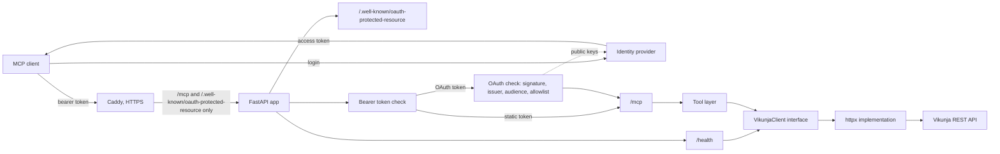

# vikunja-mcp


MCP server that exposes a self-hosted Vikunja instance as tools for MCP clients.

Work in progress.

## Status

The server runs in Docker behind Caddy with automatic HTTPS. Six tools for projects and tasks are exposed over MCP streamable HTTP, with readable error messages. The LLM website can connect with an OAuth login through a hosted identity provider (WorkOS AuthKit), and the static `MCP_AUTH_TOKEN` still works for Claude Code and scripts. CI/CD, pagination, comments and labels come next.

Set `MCP_AUTH_TOKEN` before you expose the server beyond localhost, and serve it over HTTPS because the token travels in a header.

## Setup

You need [uv](https://docs.astral.sh/uv/) installed.

Install Python 3.12 if you don't have it:

```bash
uv python install 3.12
```

Create the virtual environment and install the project with its dev tools:

```bash
uv sync
```

Check that the package imports and print its version:

```bash
uv run python -c "import vikunja_mcp; print(vikunja_mcp.__version__)"
```

Start the server (needs a `.env`, see [Configuration](#configuration)). If port in use, add flag `--port 8001`:

```bash
uv run uvicorn vikunja_mcp.main:create_app --factory --reload
```

Check if it runs:

```bash
curl localhost:8000/health
```

`/health` always returns 200. `status` is `ok` when Vikunja is reachable (with `vikunja_version`), or `degraded` when it is not.

## Deploy

The image is built from the `Dockerfile` in two stages: the first installs the locked dependencies, the second keeps only the virtual environment and runs as a non-root user. No secrets go into the image.

`compose.yml` runs the server and Caddy. Only ports 80 and 443 are published, by Caddy. The server container publishes nothing and is reachable only through Caddy.

All secrets live in a `.env` on the server, never in the repo.

The full guide, including the demo stack, is in [docs/deployment.md](docs/deployment.md).

## Configuration

Settings are environment variables, or entries in a local `.env` file.

| Variable                  | Required                | Default                          | Purpose                                                                                                                                                                                                                     |
| ------------------------- | ----------------------- | -------------------------------- | --------------------------------------------------------------------------------------------------------------------------------------------------------------------------------------------------------------------------- |
| `VIKUNJA_URL`             | yes                     | none                             | Base URL of your Vikunja instance. A trailing slash or `/api/v1` is accepted.                                                                                                                                               |
| `VIKUNJA_API_TOKEN`       | yes                     | none                             | API token used for every Vikunja request. Never logged.                                                                                                                                                                     |
| `VIKUNJA_TIMEOUT_SECONDS` | no                      | `10`                             | Seconds to wait for Vikunja before giving up. Must be greater than zero.                                                                                                                                                    |
| `LOG_LEVEL`               | no                      | `INFO`                           | Logging level: DEBUG, INFO, WARNING, ERROR or CRITICAL.                                                                                                                                                                     |
| `ALLOWED_HOSTS`           | no                      | `["localhost:*", "127.0.0.1:*"]` | Host headers accepted on `/mcp`, as a JSON list. Add your public domain when deploying.                                                                                                                                     |
| `MCP_AUTH_TOKEN`          | no                      | none                             | Shared secret for `/mcp`. Requests need the header `Authorization: Bearer <token>`, otherwise they get 401. If unset, `/mcp` is open and the server logs a warning at startup. A blank value counts as unset. Never logged. |
| `MCP_DOMAIN`              | `compose.yml` only      | none                             | Public domain Caddy serves, for example `mcp.example.com`. Its DNS A record must point to the server.                                                                                                                       |
| `DEMO_VIKUNJA_DOMAIN`     | `compose.demo.yml` only | none                             | Public domain of the demo Vikunja web UI, for example `vikunja-demo.example.com`.                                                                                                                                           |
| `DEMO_VIKUNJA_SECRET`     | `compose.demo.yml` only | none                             | Secret the demo Vikunja signs its sessions with. Create one with `openssl rand -hex 32`.                                                                                                                                    |
| `OAUTH_ISSUER`            | no                      | none                             | Address of the identity provider, for example `https://your-name.authkit.app`. Turns OAuth on together with `PUBLIC_URL`.                                                                                                   |
| `PUBLIC_URL`              | with `OAUTH_ISSUER`     | none                             | Full public address of the MCP endpoint, ending in `/mcp`, for example `https://mcp.example.com/mcp`. Also the audience checked in every token, so it must match the Resource Indicator in the identity provider exactly.   |
| `OAUTH_ALLOWED_SUBJECTS`  | no                      | `[]`                             | User ids allowed in with OAuth, as a JSON list. Empty means nobody.                                                                                                                                                         |

To create a token, run `openssl rand -hex 32` and put the result into `.env` as `MCP_AUTH_TOKEN`. `/health` stays open even when the token is set.

The server does not start if a required variable is missing or invalid.

Requests to `/mcp` with a host not in `ALLOWED_HOSTS` get `421 Invalid Host header`.

## How access works

The server picks the protection from the settings: OAuth plus the static token when `OAUTH_ISSUER` and `PUBLIC_URL` are set, only the static token when just `MCP_AUTH_TOKEN` is set, and no protection when neither is set.

### Static token (LLM website and scripts)

The client sends `MCP_AUTH_TOKEN` in the `Authorization: Bearer` header. It works in both modes and is the simple choice for Claude Code, curl and scripts.

### OAuth (LLM website)

The Claude website cannot send a fixed header, so it logs in instead. It reads the public metadata at `/.well-known/oauth-protected-resource`, sends you to the identity provider to log in, and then sends the access token it got there. The server checks the token signature with the provider's public keys, then the issuer, the audience (`PUBLIC_URL`) and the expiry.

### Who may use it

The login only proves who someone is. Anyone can sign up at the identity provider, so a valid login alone is not enough. `OAUTH_ALLOWED_SUBJECTS` decides who may use the tools: a valid token from a user id that is not on the list gets 403. An empty list lets nobody in with OAuth. The static token skips the allowlist.

## Tools

| Tool            | Arguments                                                                                                                        | Returns                                                                                                                           |
| --------------- | -------------------------------------------------------------------------------------------------------------------------------- | --------------------------------------------------------------------------------------------------------------------------------- |
| `list_projects` | `include_archived` (default false)                                                                                               | Projects with `id`, `title`, `archived`                                                                                           |
| `list_tasks`    | `project_id` (optional), `include_done` (default false)                                                                          | Open tasks with `id`, `title`, `done`, `priority`, `project_id`, `due_date`                                                       |
| `get_task`      | `task_id`                                                                                                                        | All details, including the `description` (HTML as written in Vikunja), `percent_done`, dates, labels and assignees as plain names |
| `create_task`   | `title`, `project_id` (optional, defaults to the project named Inbox), `description`, `due_date` (ISO 8601), `priority` (0 to 5) | The created task                                                                                                                  |
| `update_task`   | `task_id`, plus any of `title`, `description`, `due_date`, `clear_due_date`, `priority`, `done`. Only the given fields change.   | The updated task                                                                                                                  |
| `complete_task` | `task_id`. Marks the task done.                                                                                                  | The task                                                                                                                          |

Only the first page of results from Vikunja is returned for now. Vikunja saved filters show up as projects with negative ids (for example `My Open Tasks`). `due_date` is null when a task has no due date.

### Errors

When Vikunja is unreachable, rejects the token, or does not find something, the tool answers with a short readable message (for example `Not found: The task does not exist.`) instead of a generic failure.

`update_task` reads the task first and sends the whole task back, because Vikunja can reset fields that are missing from an update.

## Connect a client

Add the running server to Claude Code:

```bash
claude mcp add --transport http vikunja http://localhost:8000/mcp --header "Authorization: Bearer <your token>"
```

The header can be left out when `MCP_AUTH_TOKEN` is not set.

Add a deployed server the same way, with its public HTTPS address. Claude Code uses `MCP_AUTH_TOKEN`:

```bash
claude mcp add --transport http vikunja https://mcp.example.com/mcp --header "Authorization: Bearer <MCP_AUTH_TOKEN>"
```

On the Claude website, open Settings, then Connectors, and add a custom connector. Paste the MCP URL, for example `https://mcp.example.com/mcp`, and log in. This needs the OAuth settings on the server. The first login is rejected until your user id is in `OAUTH_ALLOWED_SUBJECTS`, so reconnect after the allowlist is set. The [deployment guide](docs/deployment.md) has the full steps.

> **Two different tokens.** The Vikunja API token is only for the server: it lives in the server's `.env` as `VIKUNJA_API_TOKEN` and never goes into a client. `MCP_AUTH_TOKEN` is the key clients send in the `Authorization` header. Mixing them up gives a 401. (Talking out of experience here :D.)

Or try the tools in the MCP Inspector (needs Node):

```bash
npx @modelcontextprotocol/inspector
```

## Architecture



Caddy terminates HTTPS and forwards only `/mcp` and the `/.well-known/oauth-protected-resource` paths to the app, so `/health` is not reachable from outside. Inside the stack `/health` is not behind the token check and serves the Docker health check.

With OAuth on, the client finds the identity provider in the metadata, logs in there, and sends the access token, which the server checks for signature, issuer, audience and allowlist before any tool runs.

Tools depend on the `VikunjaClient` interface, not on httpx. `create_app(settings, client)` accepts both, so tests never touch the network.

## Development

### Before you commit ✨

Run all checks (tests, lint, format check, spelling):

```bash
make check
```

Auto-fix lint and formatting issues first if needed:

```bash
make fix
```

Single checks: `make test`, `make lint`, `make format`, `make spell`.

---

Run the tests:

```bash
uv run pytest
```

Check the code for problems (unused imports, bugs, style):

```bash
uv run ruff check .
```

Fix the problems ruff can fix on its own:

```bash
uv run ruff check . --fix
```

Format the code:

```bash
uv run ruff format .
```

Check formatting without changing any file (this is what CI will run):

```bash
uv run ruff format --check .
```

### Local Vikunja

Start a throwaway Vikunja for manual testing:

```bash
mkdir -p dev-data/vikunja
docker compose -f compose.dev.yml up -d
```

Open `http://localhost:3456`, register a user, and create an API token under Settings. Use `http://localhost:3456` as `VIKUNJA_URL` in your `.env`.

Stop it, or delete all its data:

```bash
docker compose -f compose.dev.yml down
rm -rf dev-data
```

### Testing notes

Async tests are plain `async def` functions. `asyncio_mode = "auto"` in `pyproject.toml` means pytest-asyncio picks them up without a marker.

Calls to Vikunja are mocked with respx, so the test suite needs no running Vikunja and no network:

```python
@respx.mock
async def test_example(client):
    respx.get("https://vikunja.test/api/v1/projects").mock(
        return_value=httpx.Response(200, json=[])
    )
    ...
```

## Project layout

```bash
src/vikunja_mcp/   the package
  main.py          create_app, the app factory
  config.py        settings from env / .env
  auth.py          static bearer token check for /mcp
  oauth.py         JWT verifier for OAuth access tokens
  oauth_auth.py    OAuth middleware for /mcp, with the allowlist
  security.py      chooses the protection for /mcp from the settings
  well_known.py    protected resource metadata for OAuth clients
  health.py        /health endpoint
  mcp_server.py    MCP server, registers the tools
  tools/           MCP tools and their error handling
  vikunja/         Vikunja client, models, errors
tests/             tests, run with pytest
docs/              deployment guide
Dockerfile         two stage image build, runs as non-root
.dockerignore      keeps secrets, caches and tests out of the image
compose.yml        server plus Caddy for production
compose.demo.yml   adds a throwaway demo Vikunja
Caddyfile          HTTPS, forwards only /mcp and the OAuth metadata
Caddyfile.demo     same, plus the demo Vikunja web UI
compose.dev.yml    local Vikunja for manual testing
Makefile           check, fix and single checks
pyproject.toml     project metadata and tool settings
```

## Roadmap

- Milestone 2 (done): task tools, readable errors, shared-secret auth on `/mcp`
- Milestone 3 (done): Docker, HTTPS with Caddy, deploy
- Milestone 4 (done): OAuth with a hosted identity provider, so the Claude website can connect
- Next: demo seed script
- Next: CI that runs `make check`
- Next: CD with an image from a registry
- Next: pagination beyond 50 results
- Next: comments and labels as tools
- Later: retries, semantic search

## Docs

### Project

- The plan, requirements and deployment budget are available in a MD file at the moment, for this project I was planning on writing the documentation only after implementing an MVP.

### Tooling

- [uv](https://docs.astral.sh/uv/): package and environment manager
- [pytest](https://docs.pytest.org/): test runner
- [Ruff](https://docs.astral.sh/ruff/): linter and formatter
- [pydantic](https://pydantic.dev/docs/validation/dev/get-started/): data validation library
- [pytest-asyncio](https://pytest-asyncio.readthedocs.io/en/stable/concepts.html#test-discovery-modes): runs `async def` tests, hence to `auto mode`, no marker is needed
- [respx](https://lundberg.github.io/respx/): mocks httpx requests, so tests never touch the network
- [MCP Python SDK](https://github.com/modelcontextprotocol/python-sdk): MCP server and streamable HTTP transport
- [FastAPI](https://fastapi.tiangolo.com/): web framework, serves `/health` and mounts `/mcp`

### Vikunja

- [Vikunja docs](https://vikunja.io/docs/): user and admin guides
- [Vikunja API docs](https://vikunja.io/docs/api-documentation/): REST API reference, also served as Swagger on own instance at `/api/v1/docs`

### License

MIT, see [LICENSE](LICENSE).
