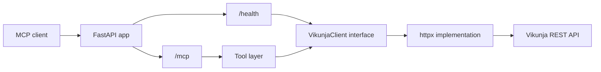

# vikunja-mcp

MCP server that exposes a self-hosted Vikunja instance as tools for MCP clients.

Work in progress.

## Status

The server runs, answers `/health`, and exposes one tool, `list_projects`, over MCP streamable HTTP. Task tools, auth on `/mcp` and Docker deployment come next.

Until auth lands, do not expose the server to the public internet.

## Setup

You need [uv](https://docs.astral.sh/uv/) installed.

Install Python 3.12 if you don't have it:

```bash
uv python install 3.12
```

Create the virtual environment and install the project with its dev tools:

```bash
uv sync
```

Check that the package imports and print its version:

```bash
uv run python -c "import vikunja_mcp; print(vikunja_mcp.__version__)"
```

Start the server (needs a `.env`, see [Configuration](#configuration)). If port in use, add flag `--port 8001`:

```bash
uv run uvicorn vikunja_mcp.main:create_app --factory --reload
```

Check if it runs:

```bash
curl localhost:8000/health
```

`/health` always returns 200. `status` is `ok` when Vikunja is reachable (with `vikunja_version`), or `degraded` when it is not.

## Configuration

Settings are environment variables, or entries in a local `.env` file.

| Variable                  | Required | Default                          | Purpose                                                                                 |
| ------------------------- | -------- | -------------------------------- | --------------------------------------------------------------------------------------- |
| `VIKUNJA_URL`             | yes      | none                             | Base URL of your Vikunja instance. A trailing slash or `/api/v1` is accepted.           |
| `VIKUNJA_API_TOKEN`       | yes      | none                             | API token used for every Vikunja request. Never logged.                                 |
| `VIKUNJA_TIMEOUT_SECONDS` | no       | `10`                             | Seconds to wait for Vikunja before giving up. Must be greater than zero.                |
| `LOG_LEVEL`               | no       | `INFO`                           | Logging level: DEBUG, INFO, WARNING, ERROR or CRITICAL.                                 |
| `ALLOWED_HOSTS`           | no       | `["localhost:*", "127.0.0.1:*"]` | Host headers accepted on `/mcp`, as a JSON list. Add your public domain when deploying. |

The server does not start if a required variable is missing or invalid.

Requests to `/mcp` with a host not in `ALLOWED_HOSTS` get `421 Invalid Host header`.

## Tools

| Tool            | Arguments                          | Returns                                     |
| --------------- | ---------------------------------- | ------------------------------------------- |
| `list_projects` | `include_archived` (default false) | List of projects with `id`, `title`, `archived` |

Only the first page of results from Vikunja is returned for now. Vikunja saved filters show up as projects with negative ids (for example `My Open Tasks`).

## Connect a client

Add the running server to Claude Code:

```bash
claude mcp add --transport http vikunja http://localhost:8000/mcp
```

Or try the tools in the MCP Inspector (needs Node):

```bash
npx @modelcontextprotocol/inspector
```

Cloud clients like the Claude web app need a public HTTPS address, that comes with the deployment milestone.

## Architecture



Tools depend on the `VikunjaClient` interface, not on httpx. `create_app(settings, client)` accepts both, so tests never touch the network.

## Development

### Before you commit ✨

Run all checks (tests, lint, format check, spelling):

```bash
make check
```

Auto-fix lint and formatting issues first if needed:

```bash
make fix
```

Single checks: `make test`, `make lint`, `make format`, `make spell`.

---

Run the tests:

```bash
uv run pytest
```

Check the code for problems (unused imports, bugs, style):

```bash
uv run ruff check .
```

Fix the problems ruff can fix on its own:

```bash
uv run ruff check . --fix
```

Format the code:

```bash
uv run ruff format .
```

Check formatting without changing any file (this is what CI will run):

```bash
uv run ruff format --check .
```

### Local Vikunja

Start a throwaway Vikunja for manual testing:

```bash
mkdir -p dev-data/vikunja
docker compose -f compose.dev.yml up -d
```

Open `http://localhost:3456`, register a user, and create an API token under Settings. Use `http://localhost:3456` as `VIKUNJA_URL` in your `.env`.

Stop it, or delete all its data:

```bash
docker compose -f compose.dev.yml down
rm -rf dev-data
```

### Testing notes

Async tests are plain `async def` functions. `asyncio_mode = "auto"` in `pyproject.toml` means pytest-asyncio picks them up without a marker.

Calls to Vikunja are mocked with respx, so the test suite needs no running Vikunja and no network:

```python
@respx.mock
async def test_example(client):
    respx.get("https://vikunja.test/api/v1/projects").mock(
        return_value=httpx.Response(200, json=[])
    )
    ...
```

## Project layout

```bash
src/vikunja_mcp/   the package
  main.py          create_app, the app factory
  config.py        settings from env / .env
  health.py        /health endpoint
  mcp_server.py    MCP server, registers the tools
  tools/           MCP tools
  vikunja/         Vikunja client, models, errors
tests/             tests, run with pytest
compose.dev.yml    local Vikunja for manual testing
Makefile           check, fix and single checks
pyproject.toml     project metadata and tool settings
```

## Roadmap

- Milestone 2: task tools and shared-secret auth on `/mcp`
- Milestone 3: Docker and VPS deployment
- Later: pagination, retries, comments, labels, JWT validation

## Docs

### Project

- The plan, requirements and deployment budget are available in a MD file at the moment, for this project I was planning on writing the documentation only after implementing an MVP.

### Tooling

- [uv](https://docs.astral.sh/uv/): package and environment manager
- [pytest](https://docs.pytest.org/): test runner
- [Ruff](https://docs.astral.sh/ruff/): linter and formatter
- [pydantic](https://pydantic.dev/docs/validation/dev/get-started/): data validation library
- [pytest-asyncio](https://pytest-asyncio.readthedocs.io/en/stable/concepts.html#test-discovery-modes): runs `async def` tests, hence to `auto mode`, no marker is needed
- [respx](https://lundberg.github.io/respx/): mocks httpx requests, so tests never touch the network
- [MCP Python SDK](https://github.com/modelcontextprotocol/python-sdk): MCP server and streamable HTTP transport
- [FastAPI](https://fastapi.tiangolo.com/): web framework, serves `/health` and mounts `/mcp`

### Vikunja

- [Vikunja docs](https://vikunja.io/docs/): user and admin guides
- [Vikunja API docs](https://vikunja.io/docs/api-documentation/): REST API reference, also served as Swagger on own instance at `/api/v1/docs`
